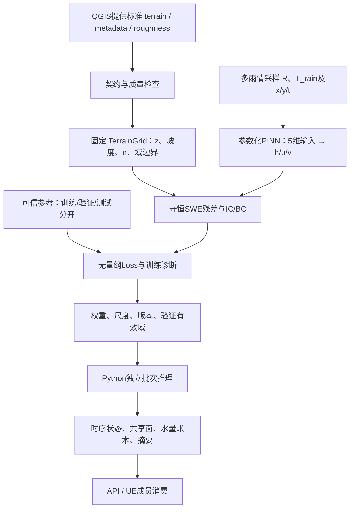

# 民雄乡固定地形、多降雨情境参数化 PINN：设计与交接规格 v0.2

> 已确认设计的历史存档。下文保留确认前原文，实际实现/测试与未完成项以`IMPLEMENTATION_STATUS.md`为准。

状态：**设计待确认，尚未实施**。本方案依据上传的v0.2需求、原程序`PINN_Case_A_inclined_plane.py`和《PINN二维真实地形淹水模拟：重构分析与接口规格v0.1》编写。原代码及仓库均不修改，不启动长时间训练，不把合成数据当民雄实测数据。

## 1. 目标、职责与相对v0.1的修订

最终交付是**固定民雄乡地形的五维参数化PINN**：`(x,y,t,R,T_rain) → (h,u,v)`。模型在经过验证的降雨参数域内直接推理，无需每次换雨情重新训练。单情境三维PINN只是物理和训练流程的中间验收门，不是最终交付，也不再把参数化功能列为可选远期扩展。

| 责任方 | 负责事项 | PINN侧交接内容 |
|---|---|---|
| QGIS成员 | 原始图资、投影、DEM/DTM整理、裁切、重采样、填洼等经确认处理、道路建筑及其他GIS资料制作 | 接收标准CSV/JSON，检查格式、数值和物理适用性；不操作QGIS、不代做地形加工 |
| 本人/PINN | 规范文件读取、坡度查询、物理残差、单情境/参数化训练、诊断验证、checkpoint、独立推理、后处理和导出 | Python函数、模型包、输入输出及错误契约、CSV/JSON、诊断图表 |
| API成员 | 服务器、HTTP、任务队列、并发、认证和文件传输 | 调用Python推理接口；不要求PINN负责人实现FastAPI |
| UE成员 | 地形场景、水面、材质、粒子、动画、UI与坐标落地 | 接收SI单位时序网格、水面、速度及坐标转换元数据；不要求PINN负责人制作UE场景 |

因此v0.1中的`gis_adapter.py`、GIS重投影/填洼/20m重采样实施，以及HTTP路由、UE消费端开发，均移出本人工作清单。保留必要的文件解析、契约校验、单位/坐标数学检查与交接样例测试。

固定条件不仅是地形：**地形/计算域、粗糙度、初始条件、边界条件定义、物理版本及支持的总模拟时间范围都属于模型版本**。本版本只将R和T_rain作为可变条件。未来若初始水位或河道流入也要随场景改变，必须明确其与雨情的确定关系，或另增模型条件并重新训练；不能让两个雨情参数隐含所有水文变化。

## 2. PINN现状分析与已发现问题

### 2.1 原程序现状

以下行号对应上传原文件，SHA-256为`4c648425b0df8ddeb9b508a2a02918a3534d38b381a808bd72938b6521840bc7`。

| 函数/位置 | 实际功能 |
|---|---|
| 参数L57–71 | 1m×1m、床面`0.10−0.05x`、n=.02；50mm/hr降雨180s，总时长300s；h_dry=1e-4m |
| `z_bed/dzdx_/dzdy_` | 固定斜面/固定坡度；无外部地形输入 |
| `rainfall(t)` | 固定R、T_rain雨源，未按样本携带不同雨情 |
| `run_fv_A`，L76–138 | HLL通量、x/2–y–x/2分裂、地形源、半隐式摩擦；返回多个时刻h；n、R、坡度等在函数内再次写死 |
| FV数据构造L147–167 | 40×40参考；60/120/150/180/240/300s，每时刻200个h锚点，共1200点 |
| `PINN`，L172–191 | 输入x/y/t，6层×128 Tanh、Xavier；Softplus水深；输出h/u/v；实际83,459参数 |
| `s_int/s_ic/s_bc` | 矩形随机采样、初始干域、四壁无通量；“边界点”向内缩eps=.001m |
| `D/residuals` | autograd求x/y/t导数；连续方程与两个守恒动量残差 |
| `compute_loss` | PDE/IC/BC/Data加权和，权重1/5/5/50；Data只监督h |
| 训练L265–293 | Adam 15000次、StepLR、梯度裁剪；LBFGS一次调用、max_iter=500；closure可能多次执行，并非恰好500次完整训练调用 |
| 保存/评估 | 只保存state_dict；t=150s在60×60网格比较h相对L2与储水差；仅单时刻图和Adam总Loss图 |

可复用：网络隐藏层和激活、初始化、Softplus思路、自动微分、四类Loss框架、两阶段优化、梯度裁剪、权重保存和参考对照思路。需要把全局变量、导入副作用和固定情境依赖拆开，而不是全部重写。

注意：原程序是使用FV锚点的混合监督PINN，不是纯无数据求解器。原注释已指出锚点用于避免近零水深解；去掉数据后，不能保证原Loss权重仍能训练成功。

### 2.2 优先修复清单

| 优先级 | 已确认问题 | 修改及验证 |
|---|---|---|
| P0 | L230将速度方程的Manning加速度项直接加到守恒动量方程；PINN与FV湿区摩擦不一致 | 使用一致的守恒摩擦和干区正则化；量纲/摩擦衰减测试 |
| P0 | HLL L91–92、99–100中状态跳跃项多除一次波速差D | 恢复标准HLL；两状态、等状态、方向反转及解析基准测试 |
| P0 | FV只截步至最大目标时刻，跨过中间目标即错标快照 | 每个目标时刻精确落步，记录实际时间；不整除时间测试 |
| P0 | 跨T_rain时间步整步用步首降雨，会多算停雨后降雨 | 在事件处截步或精确积分雨量，测试停雨后储水 |
| P1 | LBFGS closure每次重新采点 | LBFGS整个优化阶段固定情境与点集；同权重重复closure目标一致 |
| P1 | PDE/IC/Data等不同量纲直接平方相加 | 保存尺度，分别无量纲化再加权；原单位物理指标独立报告 |
| P1 | `eval_pinn`用nan_to_num掩盖NaN/Inf | 原始值有限检查；异常run失败，不用全零/极大有限值伪装 |
| P1 | t=150s参与训练，又是主要验证时刻 | 留出整时段/整雨情；原测试仅标“同刻空间重建比较” |
| P1 | “Mass residual”仅比较同刻FV与PINN总水深 | 加初始储水、累计雨量、边界交换等跨时间收支 |
| P2 | 导入即运行FV/训练，只有权重、缺少元数据和分项日志 | 安全导入、配置化、checkpoint契约和逐步日志 |

文头所称按T_rain归一化与实际`t_sc=T_end`不一致；约69k参数也不准确。负水深截零、动量裁剪和非well-balanced地形源属于需重点验证的数值风险，不能不经检测就当作稳定性保证。

### 2.3 现有证据与未验证内容

上一轮仅做了安全语法检查和AST提取后的原FV/HLL轻量检查：

- `run_fv_A([0.3,0.6],nx=ny=4)`中标记0.3s的平均h为`6.94444444444e-6m`，实际上对应0.5s；0.3s正确雨深应为`4.16666666667e-6m`。
- 静止两状态hL=.001m、hR=.002m时，原HLL质量通量`−2.5e-4m²/s`，标准HLL为`−7.00357051796e-5m²/s`。

这些支持缺陷判断，不证明修正后求解器、PINN或民雄预测已经正确。没有真实DEM、初边界、训练权重、独立参考或完整训练结果；v0.2本轮没有新增训练实验。

## 3. 最终模型架构



### 3.1 输入、网络与归一化

单情境阶段保留3维输入；参数化阶段只先改第一层为5维，保留6×128隐藏层和3维输出。参数数变为**83,715**，只增加256，网络规模不是主要新增成本。

推荐输入：

```text
ξ = (x−x_anchor)/Lx*         ψ = (y−y_anchor)/Ly*
τ = t/T*                   ρ = R_ms/R*
θ = T_rain_s/T*
网络：[ξ,ψ,τ,ρ,θ] → [a_h,a_u,a_v]
h = H* softplus(a_h),  u = U* a_u,  v = U* a_v
```

全部带星号尺度是训练前固定的正值，随模型保存；不以本次R或T_rain作分母，避免零雨/零雨时除零与情境间尺度漂移。GIS大坐标用float64先减原点再进入网络。输出始终还原为SI单位。固定高程z、坡度、n不必拼进网络输入，它们通过固定TerrainGrid进入物理残差，并由权重学习该地形的解族。

自动微分只对物理x/y/t求偏导，R/T_rain作为条件保持固定。可让带单位的x/y/t为叶节点，由forward内部归一化，autograd自然含链式尺度；如果改成直接对ξ/ψ/τ求导，则必须显式乘1/Lx*、1/Ly*、1/T*，二者不能重复应用。用已知函数验证导数量纲。

单情境到参数化可将已验证单情境模型第一层前三列拷贝、后两列初始化为0，其余层继承，以建立初始输出等价测试；此做法仅是初始化，不代表已具备多雨情预测能力。未经修正、缺元数据的原旧权重不能直接认定有效。

### 3.2 守恒SWE和固定地形源

令η=z+h，U=(u,v)，第一版固定床面，垂直降雨无水平动量、无入渗与排水：

```text
∂t h + ∂x(hu) + ∂y(hv) = R_ms · 1[0≤t<T_rain_s]
∂t(hu) + ∂x(hu²+gh²/2) + ∂y(huv) = −gh zx − τx
∂t(hv) + ∂x(huv) + ∂y(hv²+gh²/2) = −gh zy − τy

τx = g n² h sqrt(u²+v²+εu²) u / h_reg^(4/3)
τy = g n² h sqrt(u²+v²+εu²) v / h_reg^(4/3)
h_reg = max(h,h_reg_min)
```

湿区摩擦等价于`g n² |U|u / h^(1/3)`；原代码缺少乘h。n单位s/m^(1/3)，εu单位m/s；连续残差单位m/s，守恒动量残差单位m²/s²，地形源号与床面坡度方向一致。PINN与参考计算必须用同一物理和正则化约定。

粗糙度表示地表阻力，不自动包含建筑阻水、入渗、雨水口或地下管网。缺少这些过程时只称“所声明假设下的地表浅水模型”，不称已包含完整城市水文。

### 3.3 地形、干湿与边界

PINN读取规范网格后，按真实dx/dy中心差分、边缘单边差分计算坡度；以版本化插值提供z/zx/zy/n查询。二维坡度初版要求每方向至少2个格中心；单格方向须明确另选模式，不能凭空生成坡度。格中心至外边缘的半格采用明确且经过测试的单侧重建/边缘延拓，禁止查询计算域以外；边界水位约束须使用同一床面重建。解析斜面应得到准确坡度，起伏地形应验证网格细化收敛；若独立插值坡度与z导数不一致，须报告并通过静水湖检验，必要时改成一致地形插值。不得为降低Loss私自平滑/填洼。

数值正则化阈值、干格显示阈值、淹水范围阈值三者分开。保留Softplus和原始微小h，不静默删除储水；数值上不能精确全干，IC误差需单独验收。干格显示速度可置0，但保留原始速度和修正统计，物理残差/交换用原始场。

初边界由团队确认：干初始仅为合成/明确选定案例；真实初始水深/水位和u/v需有依据。wall使用`hU·n=0`，开放水位/流量边界需明确流态、特征约束、单位、沿边分配和回流处理，不能只给“open”标签。先实现wall和团队实际需要、信息充分的开放边界，未实现或条件不足的类型报错。

民雄行政边界不必是水文封闭边界。若域外来水、河道边界或潮位对模拟有影响，应由团队提供并明确是否所有雨情共用。不能默认整个乡界都是墙。

## 4. QGIS → PINN输入契约（推荐，待团队对齐）

### 4.1 必要地形文件

`terrain.csv`：UTF-8，表头精确为`cell_id,row,col,x,y,z`，每格一行；坐标为格中心，x/y/z为米。

约定row从南到北、col从西到东、二者从0开始，`cell_id=row*nx+col`；ID排序固定。

```text
x = x_edge_origin + (col+0.5)*dx
y = y_edge_origin + (row+0.5)*dy
cell_area = dx*dy
```

`terrain_metadata.json`必需内容：

| 字段组 | 内容 |
|---|---|
| 版本与来源 | schema_version、grid_id、terrain_id/version、sha256、synthetic、数据来源、处理履历 |
| 地形语义 | surface_type为DTM/DEM/DSM等明确类型；是否含建筑、桥梁等，不能由PINN自行猜测 |
| 空间参考 | CRS的EPSG标识及/或WKT、固定x/y轴序、horizontal_unit=m、vertical_unit=m、vertical_datum及其来源 |
| 网格 | 西南外边缘原点、dx/dy、nx/ny、外边缘范围extent、格中心约定、row_order、cell_id规则 |
| 数据质量 | NoData表示及处理规则、有效区域、已有处理及质量说明 |

通常地表浅水优先需要有明确处理说明的地面DTM；若交付DSM含建筑高程，必须另评估坡度/障碍表达，不能当普通平滑地面直接使用。**不预先指定民雄实际EPSG、垂直基准、域面积或分辨率**，这些由QGIS成员提供后确认。

第一版合成开发采用完整规则矩形米制网格。真实民雄范围不一定矩形：若交付含乡界掩膜、缺测洞或内部障碍，必须在接入前增加模型侧有效域/内边界支持，或由团队批准并提供物理合理的矩形计算域。不能填造乡界外地形、把NoData当0m或把计算矩形误称为完整民雄验证。

20m×20m是团队可协商分辨率；若QGIS已提供合适标准网格，PINN不负责另做GIS重采样。必要的预测输出网格变更仅作为明确约定的模型后处理，不静默修改输入地形；不同网格水深/动量需保守重映射，不能以插值结果证明20m物理精度。

### 4.2 条件与参考文件

| 文件 | 必要性、字段和单位 |
|---|---|
| `roughness.csv` | 可选；`cell_id,manning_n`，完整对齐grid_id；n单位s/m^(1/3)。缺失时显式配置常数n并记录假设，不能把演示n=.02当民雄实测值 |
| `initial_conditions.csv` | 若非明确dry模式则需要；`cell_id,h0,u0,v0`，或显式另选η0表示；h/η为m、u/v为m/s；由η0按声明规则取h0=max(η0−z,0)；直接负h0报错 |
| `boundary_segments.csv` | 确认域后提供/配置；`segment_id,face_id,type`，为实际边界唯一分配条件。简单矩形可在配置中列west/east/south/north，避免多一个文件 |
| `boundary_conditions.csv` | 时变水位/流量时必需；`segment_id,t,type,value,unit`；水位m且同垂直基准；外法向单位宽流量m²/s或总流量m³/s明确区分，负值为流入，附沿边分配方式 |
| `reference.csv` | 可信参考/观测；`reference_id,scenario_id,x,y,t,h`，可选u/v、valid和不确定度；x/y/h为m、t为s、u/v为m/s；格数据附grid_id，不能仅凭cell_id跨网格匹配 |
| `reference_metadata.json` | 来源/求解器与版本、CRS/单位/高程基准、时间起点、点值或格平均、误差/质量说明、hash与用途划分 |

初始速度缺列只有显式允许时才取0并写入假设。边界时间序列严格递增，覆盖[0,T_end]，插值为阶梯/线性必须声明，禁止范围外延用末值。粗糙度/初值有文件但缺格、错位或非有限时须报错，不能回退默认掩盖输入错误。参考稀疏观测不用凑满地形格，无速度参考就不报速度误差。

### 4.3 PINN接收检查及责任边界

检查必需字段、有限数值、唯一完整ID、数量与nx×ny、坐标中心/间距一致、正dx/dy、CRS/单位/高程基准、NoData、粗糙度/初值/边界对齐、文件版本/hash。负高程可能合法，按项目物理范围报告异常，不一律拒绝。经纬度不能当作米。

不合格地形生成`input_validation_report.json`并返回明确错误，由提供方修正标准文件。PINN不自动重投影、填洞、填洼、平滑、重新划道路建筑或转换土地利用成n。真实格式尚未签定，上述属于向QGIS成员建议的交接规范，不是假定他们已经按此交付。

## 5. 多雨情联合训练设计

### 5.1 雨源与适用范围

输入雨强mm/hr，雨时分钟或小时，显式换算：`R_ms=R_mm_hr/3_600_000`、`T_s=60*T_min=3600*T_hr`。API与函数参数单位固定，不自动猜测。

R与雨时应有限且非负；T_end>0；完整事件训练通常要求`T_rain≤T_end`，需要雨后变化时严格小于。零雨/零雨时用于无雨基准。单次单位面积累计雨深为`R_ms*min(t,T_rain_s)`；雨源接口同时提供rate和integral，供守恒精确计算。

训练前团队确定：R范围、T_rain范围、T_end、输出频率、空间域、初边界、绝对误差要求与推理延迟/内存预算。**当前不自行填写民雄实际范围。** 时间尺度T*与训练时间上限固定，不随每次雨时重算。

### 5.2 情境采样与避免只记住少数情况

1. 对R×T_rain参数域做空间填充设计，如Latin hypercube或Sobol，补边缘/角点、小雨/短时与长雨/强雨压力组合；按总雨量相近但强度/持续时间不同的成对情境检验动力差异。不能只沿固定总雨量曲线采样。
2. 固定`scenario_manifest.csv`，包含scenario_id、R、T_rain、split和来源。先用少量情境证明联合训练可行，再依据留出误差增加训练情境；具体数量依据参考预算和剖析决定，不把任意数量当精度保证。
3. 每个Adam batch先抽Bθ个训练情境，再在各情境抽x/y/t，控制总采样量，而不是一次把每个情境的4000点全部展开。雨中、停雨两侧、雨后、初始、边界与高坡度/干湿过渡区域分层覆盖。
4. 雨源使用**该点所属情境**的R和T_rain；IC/BC也遍历训练情境，Data按scenario_id匹配，不能把一个Case A雨情的锚点拿给所有条件。
5. 降雨停止带来时间导数转折。保持物理阶跃，分段采样并在停雨两侧加点；强形式PDE残差不在精确`t=T_rain`施加，该事件用精确降雨积分和解的连续性/积分约束检查。不为优化方便私自改成平滑雨源；必要的平滑近似另设物理版本并检验偏差。
6. 自适应采样/增样只使用训练或验证反馈；最终测试集锁定，不用测试误差反复选网络和情境。若测试失败后继续开发，需要新独立测试集。

### 5.3 “完整未参与训练雨情”的严格定义

按**完整(R,T_rain)组合**划分train/validation/test，测试空间/时间点也独立保存。留出的雨情不得参与PDE、IC、BC、Data或守恒Loss反传，不能只是从参考数据表删掉而仍用其PDE训练。否则只能称“未用数据锚点监督”，不能称完整未见情境。

验证集用于调参，最终test只用于最终评估。每个情境报告最差/分位和完整时序误差，不只跨情境平均。可增加留出参数小区域的严格测试，区分域内插值与更难的覆盖缺口。

若后期改为连续随机R/T采样，需要保留明确的train允许区域和留出名单/区域，避免自动采样或自适应增样污染验证/测试。有限测试不能数学保证整个连续域准确，因此有效域属于有证据支持的工程适用声明。

### 5.4 Loss、优化与验证有效域

保留`L=λp Lpde+λi Lic+λb Lbc+λd Ldata`，加入可配置全域/局部积分连续性约束。所有分项先按固定尺度无量纲化；原单位残差与梯度也记录。无参考时Data为未启用、sample_count=0，不伪造0误差或验证成功。

Adam可重采训练点，LBFGS使用固定情境/固定全部点集和固定权重，线搜索期间禁止重新采样或更新自适应权重。若需换点，结束本次LBFGS阶段并以新的优化阶段记录。达到max_iter不等于收敛。

保存两个不同对象：`training_domain`与`validated_domain`。后者可先为已通过的离散雨情白名单，或经团队确认的参数分区及其测试证据，包含适用时间/初边界/地形。某区域测试失败，即使在训练矩形内也不能自动允许可信推理；未经验证或越界返回错误，不在predict内偷偷微调。

## 6. 需要修改的函数、文件和模块

以下是建议目录，尚未创建实现；先小模块迁移，再扩展，不一次重写全部。

```text
src/flood_pinn/
  config.py, contracts.py
  terrain_io.py, terrain.py, rainfall.py, conditions.py
  model.py, physics.py, sampling.py, losses.py
  train.py, checkpoint.py, predict.py
  diagnostics.py, validation.py, visualization.py, benchmark.py
  exchange.py, water_balance.py, export.py
  reference/fv_case_a.py
configs/              # case_a、synthetic、接收后才有minxiong配置
data/examples/        # 显式synthetic样例，不放伪造民雄DEM
tests/unit/, tests/physics/, tests/integration/, tests/regression/
docs/                 # 数据交接、方程、训练/推理、适用范围说明
```

| 原代码 | 目标文件/函数 | 改动 |
|---|---|---|
| L49–71全局参数/设备/OUT | config.py / contracts.py | 显式配置、run_id、物理版本、尺度；main入口防导入训练 |
| `z_bed/dzdx_/dzdy_` | terrain_io.py:`load_terrain`；terrain.py:`TerrainGrid.query` | 从标准CSV/JSON读固定z，检查域，预计算/查询坡度与n |
| `rainfall(t)` | rainfall.py:`rate/integral` | 按每点R/T_rain；显式单位换算/范围/停雨规则 |
| `run_fv_A/hll_x/hll_y` | reference/fv_case_a.py | 优先修HLL、事件时间和一致摩擦；参数化配置；不要立刻把它扩成未经验证的全乡参考求解器 |
| FV锚点构造 | sampling.py/validation.py:`ReferenceDataset` | 加scenario_id、真实时刻/坐标、可选速度和split；训练不访问留出情境 |
| `PINN.__init__/forward` | model.py:`PINN` | 先3维保结构，再5维条件输入；尺度注入，不依赖全局变量 |
| `s_int/s_ic/s_bc` | sampling.py | 双层情境/时空采样，真实边界法向与停雨分层；LBFGS冻结 |
| `D/residuals` | physics.py:`derivative/residuals` | 保留autograd，修摩擦，固定真实z/n，当前情境雨源；记录有/无量纲三残差 |
| `compute_loss` | losses.py | 移除fv_x等全局依赖；条件IC/BC、分项/数据可选、守恒约束与有限检查 |
| Adam/LBFGS顶层循环 | train.py | 保留两阶段和梯度裁剪，阶段化运行、固定LBFGS、日志、异常/停止状态 |
| torch.save | checkpoint.py | 权重+网络/尺度/情境有效域/固定条件/软件版本+结果摘要 |
| `eval_pinn` | predict.py:`Predictor.predict` | 独立加载，兼容性/有效域检查，批次时序推理；删除nan_to_num，不调用train |
| 旧指标和图 | diagnostics/validation/visualization.py | 多时刻、逐情境、IC/BC/PDE/水量、参考误差与图 |
| 原无 | exchange/water_balance/export.py | 唯一面通量、区间积分、逐格账本、稳定索引和CSV/JSON |
| 原无 | benchmark.py | 训练step、closure、模型加载、推理/后处理/导出分项耗时与峰值内存 |

不创建QGIS工具链、GeoTIFF处理器、HTTP路由、服务部署、任务队列或UE场景代码。参考求解属于PINN验证范围，但建立复杂城市参考模型的数据、条件和可信度需团队协作，不把原Case A更改一下坡度就称为可信全乡FV。

## 7. 模型包与独立Python推理接口

### 7.1 保存内容

模型包包括权重、网络输入字段/结构/激活、SI单位和尺度/局部原点、训练参数域和已验证域、T_end支持范围、terrain/grid/hash、n/IC/BC版本/hash、物理和插值/干湿版本、参考与split版本、训练/验证报告、代码/依赖/设备/种子。训练恢复另存optimizer/scheduler状态，不混同推理必需文件。

仅文件名或terrain_id相同不等于内容相同；加载比对hash。安全加载可信state_dict及纯数据元文件，不依赖执行任意pickle对象。保存前后、CPU/GPU允许误差内的同点预测必须验证一致。

### 7.2 推理函数契约草案（不是已实现代码）

```text
Predictor.from_checkpoint(model_dir, device="auto")
predictor.predict(
    rainfall_mm_hr,
    duration_min,
    output_times_s,
    *, output_mode="complete", batch_size=None, output_dir=None
) -> PredictionResult
```

若API上游使用小时，明确转分钟，或采用另一个带unit的适配入口；不能把数值大小当单位。模型由Predictor加载一次并可由API成员缓存，多次predict不重复训练。

处理顺序：参数有限/非负与单位检查 → checkpoint/地形/n/IC/BC/物理兼容 → 验证有效域/时间范围 → 固定网格分批预测 → 原始有限检查 → 物理/输出后处理 → 可选导出。普通前向使用无梯度推理；PDE审计必须在独立小批次开启梯度，不在no_grad上下文里假装计算残差。

`output_times_s`为严格有限、范围内的时刻；规范化排序去重，返回实际时间表。`output_mode="complete"`在请求时刻基础上加入配置的常规输出时间表及0/雨中/停雨/雨后/末时刻，去重，零雨/无对应时段则标N/A；`output_mode="requested"`严格只返回排序去重后的请求帧并标`coverage=partial`，summary不称全模拟峰值，完整水量报告需相应区间。T_end来自模型支持的配置，不自动用max(output_times)替代；不能超训练时间外推。

结构化结果：`run_id,model_id,grid_id,scenario,actual_output_times_s,coverage,frames_iterator,summary,validation_status,artifacts,warnings`。大网格逐帧/分块迭代，不强制构建全部时空DataFrame；每帧记录cell_id、坐标和所需物理场。流式结果刚返回时summary状态为pending，artifacts仅列已完成文件或明确的pending条目；消费完全部帧并完成诊断/写盘后，通过`PredictionResult.finalize()`取得最终摘要和完成状态，尚未消费完时该方法返回未完成状态而非伪完整摘要。lazy模式异常可能在消费迭代器时发生，API需按该契约处理；未完成导出的run保留`status=incomplete/failed`，不可被当作完整结果。

### 7.3 错误与状态

| 错误代码 | 含义 |
|---|---|
| INVALID_ARGUMENT | 单位错误/缺失、负值、非有限数或不合法时间 |
| INPUT_DATA_INVALID / UNSUPPORTED_DOMAIN | 地形缺格/NoData/不支持的域或边界 |
| UNVALIDATED_SCENARIO | 雨情不在已验证有效域；包括训练矩形内未通过区域 |
| TIME_OUT_OF_RANGE | 超模型支持时间 |
| TERRAIN_VERSION_MISMATCH / CONDITION_VERSION_MISMATCH | 地形/n/IC/BC不匹配 |
| MODEL_INCOMPATIBLE | 网络、物理、尺度或schema版本不匹配 |
| NONFINITE_PREDICTION | 原始h/u/v或派生量出现NaN/Inf |
| PHYSICS_CHECK_FAILED | 启用的运行期物理/水量审计未达预设门槛；保留失败诊断，不标为正常可信run |
| RESOURCE_LIMIT / OUTPUT_IO_ERROR | 内存/批次资源不足或导出失败 |

返回/抛出结构化code/message/details；不转为HTTP状态码（由API成员映射），不以全零水深掩盖错误。开发诊断模式可输出标记未验证的研究结果，但正常predict默认拒绝未验证情境，不将其当可用模型输出。

## 8. PINN → API/UE输出规格

通用：UTF-8 CSV，固定表头、无额外索引列，标准JSON不含NaN/Infinity；未知可选方向CSV为空、JSON为null。每次运行run_id，固定model_id/grid_id，按`t,cell_id`排序，坐标单位米，不暗中换成UE厘米。文件与实际schema同版本交付。

### 8.1 `simulation_results.csv`

必需字段：`cell_id,x,y,t,z,h,water_surface,u,v,speed,direction,flooded`；建议另含`run_id,frame_id,row,col,is_dry,qx,qy,u_raw,v_raw`。

| 字段 | 规则 |
|---|---|
| x/y/z/h/water_surface | m；位置为固定格中心，water_surface=z+h |
| t | 自本次情境开始的s |
| u/v/speed | m/s，speed=sqrt(u²+v²) |
| direction | 度；atan2(v,u)映射[0,360)，0°=+x/东、90°=+y/北，逆时针 |
| flooded/is_dry | 0/1；按分别声明的flood_depth、dry_depth判定；不能用同一个阈值替代不同含义 |
| qx/qy | m²/s，h*u和h*v；不是每面的m³/s |

干格显示u/v/speed/qx/qy为0，direction为空；湿但近静止格direction也为空。h不被截零，u_raw/v_raw保留原始诊断；非有限值直接失败。主物理诊断与面交换用原始场，不能和干格显示场混用；显示修正量另统计。阈值取值待用途确认，原Case A仅毫米量级，1cm判淹阈值下无淹水不等于模型失败。

### 8.2 `flow_exchange.csv`

每个唯一面、每个输出区间一行：

```text
run_id,face_id,axis,minus_cell_id,plus_cell_id,boundary_tag,
face_x,face_y,normal_x,normal_y,face_length_m,t_start,t_end,
Q_start_m3s,Q_end_m3s,V_forward_m3,V_reverse_m3,V_signed_m3,
integration_method,integration_error_est_m3
```

x面统一法向+x、y面统一+y；minus/plus为负/正轴侧格，域外格为空。稳定编号：x面`row*(nx+1)+k`（k=0..nx），y面`ny*(nx+1)+j*nx+col`（j=0..ny）；同grid_id跨时刻不变。

`Q(t)=∫face h(U·n)dl`，单位m³/s；面长x方向面为dy、y方向面为dx。PINN在同一面求积一次，由邻格以相反符号引用。`V_forward=∫max(Q,0)dt`、`V_reverse=∫max(−Q,0)dt`，`V_signed=V_forward−V_reverse`，单位m³。

区间允许反向，不能把净体积正负部分当双向累计，也不能默认`Q_end*Δt`就是精确水量；时间积分处理停雨/快速变化，记录求积加密差异估计。西/南外边界向外通量为−Q，东/北为+Q；先转换再分别累计边界进出。

wall目标为零通量，但模型漏流须保留检查，不靠强制清零隐藏BC未学好。面交换不是水源溯源；原代码不支持上游来源示踪。

### 8.3 `cell_water_balance.csv`与`water_balance.csv`

逐格文件每个区间一行：`cell_id,t_start,t_end,area_m2`；每边s∈west/east/south/north的`s_Q_in_end_m3s,s_Q_out_end_m3s,s_V_in_m3,s_V_out_m3`；`V_rain_m3,V_start_m3,V_end_m3,delta_storage_m3,V_net_in_m3,balance_error_m3`。预留`V_infiltration_m3,V_drain_m3`，第一版为0且明确未建模。

```text
V_start/end = A*h_start/end（声明的格中心近似）
balance_error = (V_end−V_start)
                −(V_rain + ΣV_in−ΣV_out − V_infiltration−V_drain)
```

四边贡献只由唯一面表归并。全域`water_balance.csv`报告同一账本的初始储水、累计雨量/边界进出/损失、当前储水和余差；内部面应相消。初始IC误差单独报告，不用减去错误V0掩盖人工初始水量。

共享面反对称只保证交换账本内部一致，不保证PINN储水变化严格满足离散连续性。报告格级/全域误差及求积/中心近似误差；超标先改训练/采样/积分。可选守恒投影必须另存原始/修正通量和修正量，不能修账后宣称原模型物理已通过。

### 8.4 `simulation_summary.json`与`grid_metadata.json`

摘要：雨强与雨时的输入/SI值、T_end/实际输出时间/coverage、总雨深和体积、初末储水/边界进出/水量余差、最大水深/原始与显示速度/淹水面积及对应时间和位置、阈值、模型/地形/条件版本、有效域检查、物理/参考/雨情泛化验证状态、异常/假设。

最大值标为输出网格/时间采样峰值，不能称连续峰值；partial输出不可称整个模拟的最大值。

网格元数据：CRS/WKT/轴序、高程基准、原点、分辨率/范围/数量/面积、cell_id规则、NoData、时间/速度/流向定义、阈值、稳定面编号、model/grid版本、局部anchor及建议轴映射。重复地形可独立存一次，时序按固定索引交付。

### 8.5 大规模与UE交接

CSV可按时间分片，manifest列时间、行数、hash和grid_id；逐批推理/写盘。大规模可另提供Parquet等二进制选项，但保留CSV交接路径。API成员负责传输/缓存/任务管理。

UE成员确认局部原点p0、轴映射B和高程基准后，使用`p_UE_cm=100*B*(p_GIS_m−p0)`、`U_UE_cm_s=100*B*(u,v,0)`；水面点用z+h。源CSV仍为米。GIS与UE轴向/手性不能靠复制数学流向角解决，方向由变换后的速度向量重算。PINN侧只交付规范和数学样例测试，不写UE资产、材质或动画；未在真实API/UE消费端验证前不称端到端联调通过。

## 9. 训练诊断、物理验收与误差报告

### 9.1 必需诊断文件和图

| 文件 | 核心字段/内容 |
|---|---|
| `training_history.csv` | phase、epoch/optimizer_step、closure_eval、total/pde/ic/bc/data/conservation loss、三PDE分项、lr、elapsed_s、裁剪前后梯度范数、nonfinite和停止状态 |
| `training_report.json` | 完整配置/版本/hash/尺度/种子/设备、情境split、训练终止/收敛证据、指标/阈值/异常、可信度与有效域 |
| `physics_diagnostics.csv` | scenario_id/t/cell或审计点、三残差原单位/无量纲、IC/BC误差、干湿/负值/非有限与异常速度 |
| `water_balance.csv` | 每情境/时刻的雨量、储水、边界进出、未建模损失标记、绝对/相对余差及分母 |
| `validation_metrics.json` | 每情境MAE/RMSE/相对L2、速度误差（有参考时）、范围IoU/Precision/Recall/F1、IC/BC/PDE/水量、最差情境与性能 |
| `benchmark_report.json` | 环境、批次、加载/前向/梯度审计/通量/导出耗时、吞吐、CPU/GPU峰值内存、冷/热运行 |

图包括：分项Loss、地形、多个时刻水深、速度与方向、三PDE残差分布、水量收支/余差；有可信参考才生成误差分布。未计算的指标为null/not_evaluated，Data未启用不能当0误差。

### 9.2 验收逻辑

区分`training_completed`、`converged`、`physics_checks_passed`、`reference_validation_status`、`held_out_scenario_status`、`inference_compatibility_passed`、`performance_status`。单一Loss低、迭代结束或权重保存都不是综合成功。

先定义物理尺度和业务容差，再训练。可沿用v0.1的**合成基准建议初值**：各归一化IC/BC误差≤.01；独立审计点无量纲三残差RMS≤.05、P95≤.1；每时刻全域相对水量误差≤1%且满足绝对m³容差；这些不是民雄实际精度认证。正式深度/速度/范围和延迟门槛待团队按观测误差与用途设定，未设定则验收not_evaluated。

绝对/相对误差同时报告。相对水量分母预先定义并给正的带单位下限，无雨干域改用绝对指标；参考h范数近零时相对L2为N/A。范围双方为空时标注空集，不自动算完美IoU。参考时空匹配方法、点值/格平均支撑、CRS/基准必须一致。

同时检查格级水量余差、墙面累计漏流、初始人工水量、干区原始速度和求积细化变化；仅全域小误差可能隐藏局部正负抵消。不同雨情逐一达标，不能用平均值掩盖强雨/边缘失败。

没有可信参考时可以说“内部物理检查通过”，但必须明确“尚未完成外部验证”，不宣称民雄真实预测精度。修复后的自有FV只有通过解析/静水/细化验证后才可供锚点；同一个FV产生训练和测试结果主要说明对该求解器的一致性，不等于独立真实观测认证。

基础日志与水量检查从首次单情境训练就必须有。用户开发顺序中的“诊断阶段”是完善体系，不是等参数化训练结束才第一次检查数值异常。

## 10. 分阶段任务、测试、交付与验收

以下测试为实施阶段拟建分组，不声称当前已有代码或通过结果。先合成，收到真实标准文件后在固定民雄数据版本上复验；缺真实资料不阻止合成开发，也不能跳过真实验收。

| 阶段 | 任务与交付 | 测试与验收门槛 |
|---|---|---|
| 1 现状/基线 | 冻结原脚本hash和Case A配置；建立导入/最小前向基线，列旧缺陷 | 网络结构/83,459参数、同权重前向等价；导入不自动训练；不把原错误数值当正确性门槛 |
| 2 物理/FV修复 | 统一摩擦、HLL、精确快照/停雨、确定性LBFGS | 两状态/等状态通量、0.3s快照回归、停雨精确雨量、无雨/均匀雨封闭解析解、摩擦衰减、湿湖/干湿岸线静止；记录裁剪修正体积；FV网格与步长细化 |
| 3 输入合同 | QGIS文件schema、输入报告、合成示例、初边界格式 | 缺字段/重复/错位/NaN/单位/不支持掩膜必须报错；标准CSV/JSON回读；合成标记不可缺 |
| 4 地形接入 | 规范读取、内部TerrainGrid、z/zx/zy/n查询 | 解析斜面坡度、起伏函数细化收敛、坐标原点与单位、地形hash变更检测；真实文件到位后逐项复验 |
| 5 单情境验收 | 先小网络短跑，再经确认的完整单情境；可信参考比较、初步h/u/v/水量与诊断 | Loss/梯度有限、IC/BC/PDE/水量达预设门槛；独立时间/空间参考误差；无参考标未验证；短跑只验管线，不称收敛 |
| 6 参数化模型 | 5维网络、情境manifest、双层采样、固定LBFGS点、训练/验证有效域 | 初始迁移等价；样本雨源按情境变化；整个留出雨情不进入任何训练Loss；未见组合各指标达标、边缘压力/不同同总雨量情境检验 |
| 7 完整诊断验证 | 所有诊断表/报告/图；统一判定与性能报告 | 注入NaN能失败留痕；无参考null；重算分项/水量一致；最差情境、各通过状态和未运行项明确 |
| 8 保存/推理 | model包、Predictor、错误契约、batch/iterator | 新进程推理不训练；保存前后同点一致；错地形/条件/物理/雨情/时间拒绝；有限检查；冷/热耗时和峰值内存实测 |
| 9 时序/交换输出 | 全部CSV/JSON、manifest、共享面/逐格账本 | 所有帧同ID/坐标；z+h/speed/方向；每面两格反号；正反流分开积分；停雨分段；内部面全域相消；局部/全域余差、求积加密及CSV回读 |
| 10 交接联调 | 模型包、Python调用说明、错误/数据字典、最小交接样例 | PINN侧schema、单位、索引、2×2格东/北向量与anchor换算；API/UE成员实际消费后共同记录端到端联调结论 |

每阶段小改动、独立测试，非物理迁移要求等价，物理缺陷修正另立经验证基线。完整Case A保留作为回归，真实地形结果另建版本；未经修正的原图/指标不能要求逐值复现。增加参数化不删除三维单情境测试，保证出现失败时能定位到地形/物理还是条件学习。

## 11. 技术可行性与成本评估

### 11.1 可行性判断

固定几何和仅两个变化雨情参数使参数化方案具有合理的最小改动路径；比泛化到未知城市更可控。但全乡复杂起伏、干湿边界、河道、水跃和缺失排水物理可能使单个光滑MLP难以同时满足所有情境。此时即使训练Loss很低，也可能漏峰、平滑锋面或局部不守恒。

结论应通过三道门逐步建立：解析/合成物理基准 → 固定真实地形单情境参考 → 同地形完整留出雨情。单情境失败不直接扩到五维碰运气；联合训练失败也不直接交付未经验证的实时模型。

### 11.2 当前资源事实与不能承诺的事项

本轮只读检查：可见5个逻辑CPU，cgroup CPU配额`400000/100000`约4核，内存上限34,359,738,368字节即32GiB；未发现nvidia-smi，PyTorch尚未安装，**GPU可用性尚未验证**。NumPy/Matplotlib/SciPy可用。没有实际PINN step、训练耗时或显存实测，不提供编造的GPU/CPU小时数。

CPU适合单位测试、合成小网格、短训练与接口/输出验证；全乡多情境训练应先评估GPU能力，不承诺当前CPU实例能在可接受时间内完成。依赖与设备安装/激活留到用户确认后的实施阶段，不为设计报告擅自启动训练。

### 11.3 成本模型与规模例子

```text
训练总时长 ≈ Ns_ref * 单情境参考求解时长
           + N_Adam * 实测每step秒
           + N_closure * 实测每closure秒
           + 验证/后处理/导出耗时

预测样本数 = N_cells * N_times
完整导出额外代价 ≈ 面数 * 空间求积点 * 时间求积点
```

多雨情第一层只多256参数，主要成本是更多情境覆盖、每点自动微分图、参考生成、验证和输出。PINN训练可随机采点而非每步遍历整张地形，但细节覆盖仍需足够点数/容量；不能由参数数小推断全乡很便宜。

仅作规模示例：10km×10km、20m格为250000格；121帧约3025万状态行，若每行约200字节约6GB；共享面数量约50万，120个区间约6000万面记录，再加逐格账本。此示例**不是民雄实际范围**。全量CSV与求积可能比单次网络前向慢很多，实时显示不应每次强制生成所有诊断CSV。

参考FV二维均匀细化在相近波速/CFL下，格数约随dx^−2、时间步数约随dx^−1增长，计算量可能接近dx^−3；不能盲目把40×40直接放大到全乡高分辨率。需先做参考成本和质量评估。

### 11.4 经确认后的性能剖析计划

先核实设备/依赖，以小批次预热，测50–100个Adam step和小规模确定性LBFGS调用，记录closure次数、墙钟、CPU RSS/GPU峰值内存，再据目标点数与阶段预算外推；这些是后续拟议测量，不是本轮已执行。

逐步增batch，CPU线程初始不超可用配额，GPU分别测前向/自动微分；不能将CPU结果乘一个固定倍数当GPU估计。训练支持按情境/点分批累积梯度；LBFGS如分批，仍必须评估同一个固定全目标。

性能报告分开：冷启动加载、缓存后推理、PDE审计、面通量/时间积分、CSV写入；报告每帧/全情境耗时、峰值内存和吞吐。GPU测时同步设备，warm/cold不混报。大网格分批/流式；完整场推理与完整诊断两个模式，不能用只跑前向的耗时冒充全报告交付延迟。

## 12. 若精度或性能未达标：可验证改进顺序

| 触发问题 | 优先改进 | 必须如何验证 |
|---|---|---|
| 平凡小水深/不同情境Loss失衡 | 量纲/尺度复查、逐情境均衡、可信锚点、积分连续性、雨中/雨后分层 | 平地解析雨量、保留点残差与留出情境误差共同改善，不仅训练Loss下降 |
| 局部前缘/水跃或高坡区误差 | 自适应采样、局部加密；再评估弱形式/守恒PINN或域分解 | 同参考同划分对照；域分解需界面水面/通量耦合，不能独立瓦片断流 |
| 参数域内局部雨情失败 | 只增加训练情境/参考，或缩小已验证域；必要时分雨情范围子模型 | 使用新留出组合测试；子模型选择和交界处一致性透明，不在predict临时训练 |
| 单MLP容量不足 | 逐项评估位置/时间特征或适度容量增加 | 同预算/参考比较，精度、稳定性和推理成本同时报告 |
| 物理过程缺失导致系统偏差 | 明确向团队申请所需条件，另版本引入入渗/排水/建筑模型 | 独立观测/可信参考检验，不能仅加深网络补偿缺物理 |
| 仍无法满足可信度/延迟 | 将经验证二维浅水FV作为备用求解器，或离线可信情境库作有限范围交付 | 明确标为FV/预计算，不冒称PINN；连续雨情插值需另外验证，未验证组合拒绝；任务调度仍由API成员负责 |

更大改进或备用路线需要独立决策，不在本轮默认替换PINN目标。每次比较冻结参考、划分、阈值并记录变更；不能反复使用最终测试集挑方案后仍把它称独立测试。

## 13. 缺失条件与建议确认内容

| 条件 | 需要团队提供/共同确认 | 对当前工作的影响 |
|---|---|---|
| 标准地形 | 民雄计算域、地面/表面语义、CSV/metadata、CRS/垂直基准/分辨率/NoData | 合成阶段可继续；真实接入/验收必需 |
| 固定初边界 | 初水深/水位/速度、每条边界及所需过程、是否随雨情变化 | 不可默认四壁全干是真实民雄 |
| n及未建模作用 | n分布/常数依据，建筑/排水/入渗影响与第一版限制 | 记录假设；复杂物理不能靠字段存在冒充实现 |
| 参数域/时间 | 期望R/T_rain范围、T_end/雨后时长、输出频率、零雨支持 | 确定采样和checkpoint有效域，当前不发明实际范围 |
| 参考与精度 | 可信FV/观测、质量/误差、深度/速度/范围验收标准 | 无参考不能认证真实准确度 |
| 成本与交接 | GPU/耗时预算、每帧/全情境延迟、内存/文件大小、API函数契约、UE anchor/轴向 | 决定batch、采样、导出与接口实际验收 |

建议确认：以五维参数化模型为最终目标，按“修复Case A → 合成地形单情境 → 民雄固定数据单情境 → 多雨情联合训练 → 独立推理/输出”推进；采用本文件的标准CSV/JSON与Python接口作为团队讨论稿；初期不实现GIS加工、HTTP服务或UE场景。基础诊断从第一次训练开始，长训练在获得明确预算和确认后执行。

**本轮交付为以上七项设计内容及交接规格，等待用户确认后才逐模块提供代码与可执行测试步骤。**
